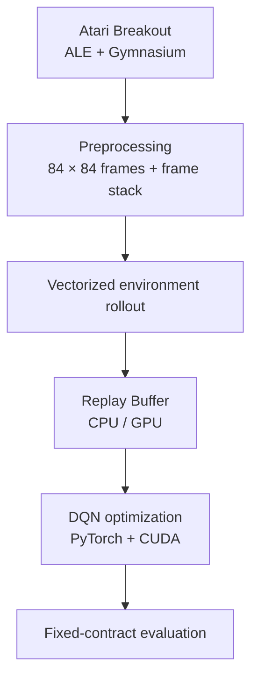
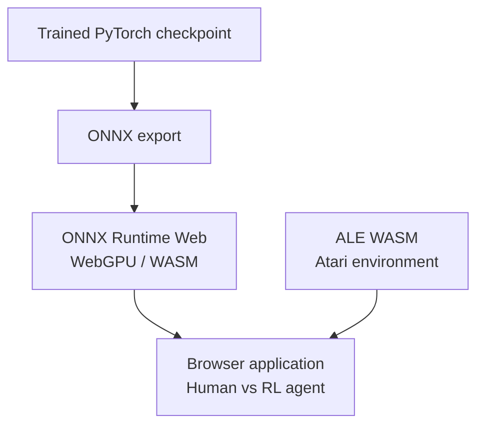

# Breakout RL Engineering

[繁體中文](README.zh-TW.md) · [Live Demo](https://breakout.tommypan.com) · [Case Study](https://breakout.tommypan.com/case-study.html) · [Final Results](docs/final-results/README.md) · [30-Day Ironman Series](https://github.com/Tommyweige/breakout-rl-engineering/tree/docs-ironman-series/docs)

An end-to-end reinforcement learning engineering project for Atari Breakout, covering DQN training, reproducible evaluation, CUDA-accelerated workflows, ONNX inference, and browser deployment.

The final application runs both the Atari environment and the trained RL policy directly in the browser, without a Python backend.

> **Project status: frozen evidence closeout (2026-10-28).** This repository is a completed engineering case study, not an active training campaign. **No verified full clear has been recorded.** Contracts, metrics, provenance, and limitations are indexed in [`docs/final-results/`](docs/final-results/README.md); the public narrative is the [interactive case study](https://breakout.tommypan.com/case-study.html).

## Key Findings

- **The DQN family produced a working browser policy, not a solved game.** Dueling Double DQN was selected after the 500K/1M family screen. The frozen 2.5M-transition checkpoint has a reported holdout mean of **30.933** raw score under Contract v2 (15 episodes, historical reported). The raw holdout episodes are not in `main`.
- **A deterministic pixel controller is cheaper and explainable, but it did not clear.** Under Contract v3 it reported a mean of **137.47** with **0/15** canonical clear detections (historical reported). Its score is **not directly comparable** with the DQN holdout: v2 decides every four emulator frames, v3 every frame.
- **No verified full clear exists.** The audited detector requires destroying both brick walls (864 points) and validates its positive path with a synthetic RAM/reward fixture, not a natural ALE clear. Phase 2/3 of the [roadmap](https://github.com/Tommyweige/breakout-rl-engineering/issues/14) remain deferred.
- **Negative and inconclusive results are part of the record.** Life-loss reward shaping did not pass its promotion gate; PER was descriptive only; the first-clear probes ended without a verified clear; the Laya Vision side experiment has latency measurements but no complete episode.

“Unbeatable” in the browser UI is a **difficulty label** (no deliberate mistake injection), not an experimental result. The project makes no world-record, “solved”, stable-clear, or fair-method-winner claim.

## Highlights

- **DQN family** — Vanilla DQN, Double DQN, and Dueling Double DQN.
- **GPU training** — PyTorch with CUDA support and vectorized environments.
- **Replay systems** — CPU and GPU replay-buffer implementations.
- **Reproducible evaluation** — fixed environment and evaluation semantics through a machine-readable contract.
- **Inference pipeline** — PyTorch to ONNX and ONNX Runtime.
- **Browser deployment** — Atari emulation with ALE WASM and policy inference with ONNX Runtime Web.
- **Engineering structure** — reusable Python package, CLI entry points, active configs, regression tests, and a production web app.

## Architecture

### Training and evaluation



The training path supports Vanilla DQN, Double DQN, and Dueling Double DQN under the same environment and evaluation contract.

### Deployment



The deployed browser application combines the Atari emulator and the ONNX policy locally, so gameplay and inference do not require a Python backend.

## Project Structure

```text
breakout_rl/   Reusable RL, training, evaluation, and inference code
configs/       Active training, evaluation, and inference configuration
scripts/       Training, evaluation, analysis, and benchmark CLIs
tests/         Core correctness and regression tests
web/           Browser application and runtime model assets
```

The `main` branch contains the maintained implementation and product code. The 30-day article series and its documentation assets are maintained separately on the [`docs-ironman-series`](https://github.com/Tommyweige/breakout-rl-engineering/tree/docs-ironman-series) branch.

## Environment Contract

Atari RL results are sensitive to environment semantics such as frame skip, frame stack, sticky actions, FIRE handling, life-loss handling, and episode limits.

The historical benchmark contract remains:

```text
configs/eval/breakout_contract_v2.json
```

Precision-control training and evaluation can select:

```text
configs/eval/breakout_contract_v3.json
```

Contract v2 makes one policy decision per four emulator frames. Contract v3
makes one decision per emulator frame while keeping the same 108,000-frame ALE
episode limit and other gameplay settings. Thus the corresponding agent-step
limits are 27,000 and 108,000. Training and evaluation summaries keep agent
steps separate from emulator frames, which are read from ALE's native counter.
Select v3 explicitly with `--contract configs/eval/breakout_contract_v3.json`;
the default remains v2. Use the contract ID and path recorded in each artifact
when comparing results.

## Training

The maintained training entry points are:

```text
scripts/training/train_dqn.py
scripts/training/train_vectorized_dqn.py
```

The vectorized training path is designed for higher-throughput collection and CUDA-backed optimization.

Available baseline configurations include:

```text
configs/dqn_baseline.json
configs/double_dqn_baseline.json
configs/dueling_double_dqn_baseline.json
configs/dueling_double_dqn_life_loss_penalty.json
```

The Issue #9 reward-shaping experiment keeps the raw Atari reward separate
from the replay/training reward. The baseline uses `life_loss_penalty: 0.0`
and the experiment uses `-1.0`, applied only when
`info["fire_reset_life_loss"]` is true. Evaluation always reports the raw
Breakout score.

The reproducible Stage 2 screening sweep uses Dueling Double DQN, seed `2022`,
`250000` environment transitions, and otherwise identical configs for penalties
`0.0`, `-0.25`, `-0.5`, and `-1.0`:

```bash
python -m scripts.training.run_reward_shaping_sweep \
  --output-dir experiments/issue-9-reward-shaping/stage2-250k --parallel
python -m scripts.evaluation.evaluate_reward_shaping_sweep \
  --stage-dir experiments/issue-9-reward-shaping/stage2-250k
```

Each run saves its config, checkpoints, metrics, runtime summary, Q/TD-error
diagnostics, survival metrics, analysis report, and learning curves. The
evaluation uses the predeclared 50-seed raw-score protocol. Stage 2 is candidate
screening; it does not promote a model or replace the formal Day 30 artifacts.

## Evaluation

Maintained evaluation entry points:

```text
scripts/evaluation/baseline_random_agent.py
scripts/evaluation/evaluate_dqn.py
scripts/evaluation/evaluate_vectorized_dqn.py
scripts/evaluation/evaluate_reward_shaping.py
scripts/evaluation/evaluate_reward_shaping_sweep.py
scripts/evaluation/evaluate_predictive_controller.py
```

Evaluation is separated from training so model comparisons can run under consistent task semantics.

The deterministic predictive controller uses raw ALE RGB pixels and does not
train a model. Its versioned config references Breakout Contract v3, preserving
the one-frame decision cadence and fixed evaluation seeds without changing the
shared v2 or v3 contracts:

```bash
python -m scripts.evaluation.evaluate_predictive_controller \
  --config configs/eval/breakout_vision_controller_v1.json \
  --output-dir outputs/issue25-vision-controller
```

The run writes per-episode scores and canonical clear detections, perception/control
diagnostics, a first-episode ALE step trace, and a compact comparison report.
The controller consumes screen frames only; FIRE handling and canonical clear
detection stay in the external environment/evaluation pipeline. Clear counts use
the audited `BreakoutCompletionDetector`; they do not establish the repository's
`verified_clears`, which requires separate contract/source/provenance validation.
Trace and distribution fields distinguish `requested_action` (controller decision)
from `ale_input_action` (after FIRE wrapper overrides, sent to ALE). ALE sticky
actions may repeat a previous action; the physical action resolved by ALE is not observed.

## Browser Demo

**Live:** https://breakout.tommypan.com

**Research results:** https://breakout.tommypan.com/case-study.html

The case-study page is an independent, directly linkable summary of the research question, method evolution, contracts, results, and limitations. The game page links to it without changing the Human vs AI gameplay surface.

The web application uses:

- [`@farama/ale-wasm`](https://www.npmjs.com/package/@farama/ale-wasm) for Atari emulation in the browser.
- [`onnxruntime-web`](https://www.npmjs.com/package/onnxruntime-web) for policy inference.
- TypeScript and Vite for the browser application.
- WebGPU or WASM execution paths depending on browser capability.

Runtime model assets are stored under `web/public/` because they are required by the deployed application.

## Quick Start

### Python

```bash
conda env create -f environment.yml
conda activate breakout-rl-engineering

python -m scripts.training.train_vectorized_dqn --help
python -m scripts.evaluation.evaluate_dqn --help
```

The current environment targets Python 3.12 and includes PyTorch with CUDA support, Gymnasium, ALE, ONNX, and ONNX Runtime GPU.

### Web

```bash
cd web
npm install
npm run dev
```

Production build:

```bash
npm run build
```

## Tech Stack

**RL / ML**

- Python 3.12
- PyTorch
- Gymnasium
- ALE / `ale-py`
- NumPy

**Inference / Deployment**

- ONNX
- ONNX Runtime GPU
- ONNX Runtime Web
- WebGPU / WASM

**Web**

- TypeScript
- Vite
- Vitest
- Cloudflare Pages / Wrangler

## Final Results

The frozen evidence pack lives in [`docs/final-results/`](docs/final-results/README.md):

- [`README.md`](docs/final-results/README.md) — results index, contract comparison, limitations, and rerun commands.
- [`summary.json`](docs/final-results/summary.json) — machine-readable metrics with `value`, `unit`, `contract`, `seed_count`, `source`, `ref`, and `verification_status`.
- [`evidence-inventory.csv`](docs/final-results/evidence-inventory.csv) — experiment ledger with raw-artifact status.
- [`artifact-manifest.json`](docs/final-results/artifact-manifest.json) — expected raw-artifact paths, producers, hashes, and missing/not-created status.
- [`handoff.md`](docs/final-results/handoff.md) — deferred work, Laya blockers, release/deploy/rollback notes, and the `tommypan.com` handoff.

Read the contract before quoting a score. The DQN holdout and the RGB controller were evaluated under Contract v2 and v3 respectively; they are **not directly comparable**.

## Known Limitations

- The raw DQN, controller, reward-shaping, PER, and Laya run outputs are not in `main`; the corresponding numbers are historical reported rather than independently reproducible from this checkout.
- No verified full clear exists. The completion detector's positive path has a synthetic 864-point fixture, not a natural ALE trajectory.
- Contract v2 and v3 change the decision cadence. No matched cross-contract comparison was run, and this repository does not claim a fair method winner.
- The DQN holdout is one model and 15 episodes; the controller result is one 15-seed run.
- Laya has latency measurements but no complete episode, and its draft PR #74 still needs real browser QA. Issues #70–#72 remain open.
- No 50-episode browser evaluation or world-record/human-timed attempt was completed in this closeout.

## Documentation

The development notes and 30-day Ironman series are available on the documentation branch:

[**Browse the 30-Day Ironman Series →**](https://github.com/Tommyweige/breakout-rl-engineering/tree/docs-ironman-series/docs)

The frozen closeout is on `main`:

[**Final results index →**](docs/final-results/README.md) · [**Handoff and deferred work →**](docs/final-results/handoff.md)
