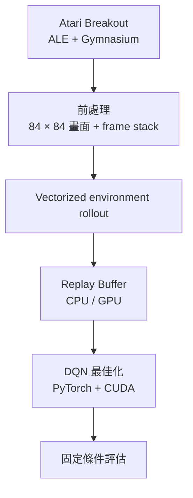
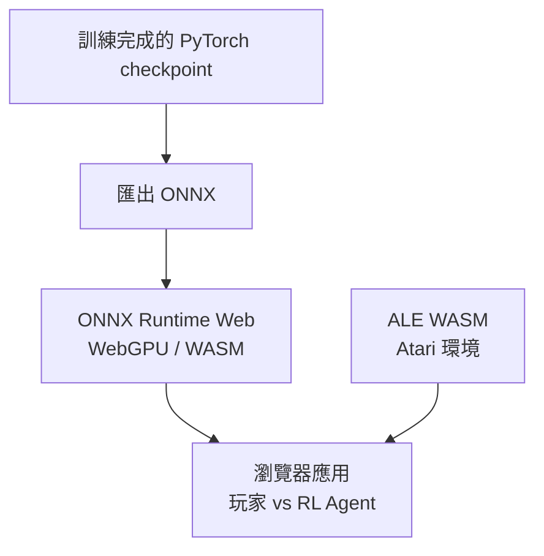

# Breakout RL Engineering

[English](README.md) · [線上 Demo](https://breakout.tommypan.com) · [Case Study](https://breakout.tommypan.com/case-study.html) · [最終結果](docs/final-results/README.md) · [重現路徑](docs/repro/README.md) · [30 天鐵人賽文章](https://github.com/Tommyweige/breakout-rl-engineering/tree/docs-ironman-series/docs)

這是一個以 Atari Breakout 為主題的端到端強化學習工程專案，涵蓋 DQN 訓練、可重現評估、CUDA 加速、ONNX 推論，以及瀏覽器部署。

最終應用會直接在瀏覽器中執行 Atari 環境與訓練完成的 RL policy，不需要 Python backend。

> **專案狀態：證據收尾凍結（2026-10-28）。** 這是一個已完成的工程案例，不是持續進行的訓練計畫。**目前沒有記錄任何 verified full clear。** Contract、指標、provenance 與限制都整理在 [`docs/final-results/`](docs/final-results/README.md)；對外敘事入口是 [互動式 case study](https://breakout.tommypan.com/case-study.html)。

## 重點發現

- **DQN family 產出了可用的瀏覽器 policy，但沒有破關。** 500K/1M family screen 後選用 Dueling Double DQN。凍結的 2.5M-transition checkpoint 在 Contract v2 下回報 holdout mean **30.933**（15 局，historical reported）。原始 holdout 逐局紀錄不在 `main`。
- **Deterministic pixel controller 更便宜、可解釋，但沒有 clear。** 在 Contract v3 下回報 mean **137.47**、**0/15** canonical clear detections（historical reported）。這個分數與 DQN holdout **不能直接比較**：v2 每四個 emulator frames 做一次決策，v3 每個 frame 做一次。
- **目前沒有 verified full clear。** Audited detector 要求打掉兩面磚牆（864 分），且正向路徑只用 synthetic RAM/reward fixture 驗證，尚未在自然 ALE 軌跡上觀察到。 [#14](https://github.com/Tommyweige/breakout-rl-engineering/issues/14) 的 Phase 2/3 維持 deferred。
- **負面與未定論結果也是紀錄的一部分。** Life-loss reward shaping 未通過 promotion gate；PER 只有描述性結果；first-clear probes 沒有 verified clear；Laya Vision side experiment 有延遲量測，但沒有完整 episode。

瀏覽器 UI 的「Unbeatable」是**難度名稱**（不注入刻意失誤），不是實驗結論。本專案不宣稱世界紀錄、已破關、穩定 clear，或方法公平勝出。

## 專案重點

- **DQN 系列模型** — Vanilla DQN、Double DQN、Dueling Double DQN。
- **GPU 訓練** — 使用 PyTorch、CUDA 與 vectorized environments。
- **Replay 系統** — CPU 與 GPU Replay Buffer 實作。
- **可重現評估** — 透過 machine-readable contract 固定環境與評估語義。
- **推論流程** — PyTorch、ONNX 與 ONNX Runtime。
- **瀏覽器部署** — 使用 ALE WASM 執行 Atari，並以 ONNX Runtime Web 執行 policy inference。
- **工程化結構** — reusable Python package、CLI、active configs、regression tests 與 production web app。

## 系統架構

### 訓練與評估



Vanilla DQN、Double DQN 與 Dueling Double DQN 都使用相同的環境與評估 contract，方便在一致條件下比較。

### 部署流程



瀏覽器端會同時執行 Atari emulator 與 ONNX policy，因此遊戲與模型推論都不需要 Python backend。

## 專案結構

```text
breakout_rl/   可重用的 RL、訓練、評估與推論程式碼
configs/       目前使用中的訓練、評估與推論設定
scripts/       訓練、評估、分析與 benchmark CLI
tests/         核心 correctness 與 regression tests
web/           瀏覽器應用與 runtime model assets
```

`main` 分支只保留目前維護中的實作與產品程式碼。30 天鐵人賽文章與對應文件資產放在 [`docs-ironman-series`](https://github.com/Tommyweige/breakout-rl-engineering/tree/docs-ironman-series) 分支。

## Environment Contract

Atari RL 的結果會受到 frame skip、frame stack、sticky actions、FIRE handling、life-loss handling 與 episode limit 等環境條件影響。

歷史 benchmark 使用：

```text
configs/eval/breakout_contract_v2.json
```

需要精細控制時，訓練與評估可明確選用：

```text
configs/eval/breakout_contract_v3.json
```

Contract v2 每個 policy decision 推進四個模擬器影格；v3 每個 decision
推進一個影格，並保留相同的 108,000 個 ALE episode 影格上限與其他遊戲
設定。因此兩者的 agent-step 上限分別是 27,000 與 108,000。訓練和評估
摘要會分開記錄 agent steps 與 emulator frames；影格數取自 ALE 原生計數器。
使用 `--contract configs/eval/breakout_contract_v3.json` 明確選用 v3；預設仍是
v2。比較結果時請一併確認 artifact 記錄的 contract ID 與路徑。

## 訓練

目前保留的訓練入口：

```text
scripts/training/train_dqn.py
scripts/training/train_vectorized_dqn.py
```

Vectorized training path 用於提高資料收集 throughput，並搭配 CUDA 執行模型最佳化。

Baseline 設定包含：

```text
configs/dqn_baseline.json
configs/double_dqn_baseline.json
configs/dueling_double_dqn_baseline.json
configs/dueling_double_dqn_life_loss_penalty.json
```

Issue #9 的 reward shaping 實驗會把 raw Atari reward 與 replay/training
reward 分開保存。Baseline 使用 `life_loss_penalty: 0.0`，實驗版本使用
`-1.0`，而且只在 `info["fire_reset_life_loss"]` 為 true 時套用。評估時
仍然只回報原始 Breakout 分數。

Stage 2 的可重現 screening sweep 使用 Dueling Double DQN、training seed
`2022`、`250000` 個 environment transitions；除了 penalty 之外的條件
完全一致，比較 `0.0`、`-0.25`、`-0.5`、`-1.0`：

```bash
python -m scripts.training.run_reward_shaping_sweep \
  --output-dir experiments/issue-9-reward-shaping/stage2-250k --parallel
python -m scripts.evaluation.evaluate_reward_shaping_sweep \
  --stage-dir experiments/issue-9-reward-shaping/stage2-250k
```

每個 run 都會保存 config、checkpoint、metrics、runtime summary、Q/TD-error
diagnostics、survival metrics、analysis report 與 learning curves。評估使用
預先宣告的 50 組 seed，且只比較 raw score。Stage 2 只是 candidate screening，
不會提升任何模型，也不會覆蓋既有 Day 30 formal artifacts。

## 評估

目前保留的評估入口：

```text
scripts/evaluation/baseline_random_agent.py
scripts/evaluation/evaluate_dqn.py
scripts/evaluation/evaluate_vectorized_dqn.py
scripts/evaluation/evaluate_reward_shaping.py
scripts/evaluation/evaluate_reward_shaping_sweep.py
scripts/evaluation/evaluate_predictive_controller.py
```

評估流程與訓練流程分離，讓不同模型能在一致的 task semantics 下進行比較。

確定性預測控制器直接使用 ALE RGB 畫面，不需要訓練模型。版本化設定檔
沿用 Breakout Contract v3 的一影格決策頻率與固定 evaluation seeds，不修改
共用的 v2 或 v3 contract：

```bash
python -m scripts.evaluation.evaluate_predictive_controller \
  --config configs/eval/breakout_vision_controller_v1.json \
  --output-dir outputs/issue25-vision-controller
```

執行後會保存每局分數與 canonical clear detections、感知/控制診斷、第一局 ALE 逐步軌跡，
以及精簡比較報告。控制器只讀取畫面；FIRE handling 和 canonical clear detection
仍由外部環境與評估流程負責。Clear 計數使用 audited `BreakoutCompletionDetector`，
不代表已通過 repository `verified_clears` 所要求的 contract/source/provenance validation。
軌跡與動作分布區分 `requested_action`（controller 原始決策）與 `ale_input_action`
（FIRE wrapper 覆寫後送進 ALE 的動作）。ALE sticky actions 可能重複上一個動作；
目前無法觀察 ALE 決定後真正執行的 physical action。

## 瀏覽器 Demo

**線上版本：** https://breakout.tommypan.com

**研究結果：** https://breakout.tommypan.com/case-study.html

Case-study 頁面是獨立、可直接連結的研究問題、方法演進、contract、結果與限制摘要。主遊戲頁可以明顯進入該頁，且不改變 Human vs AI 遊玩介面。

Web application 使用：

- [`@farama/ale-wasm`](https://www.npmjs.com/package/@farama/ale-wasm)：在瀏覽器執行 Atari emulator。
- [`onnxruntime-web`](https://www.npmjs.com/package/onnxruntime-web)：執行訓練完成的 policy。
- TypeScript + Vite：瀏覽器應用。
- WebGPU / WASM：依照瀏覽器能力選擇推論執行路徑。

部署所需的 runtime model assets 保留在 `web/public/`。

## 快速開始

完整乾淨 clone 流程、系統依賴、ALE ROM 來源、conda 與 venv 的取捨、已知測試失敗、CI 與版本標記都在 [`docs/repro/`](docs/repro/README.md)。

### Python

CPU-only、Linux（以 Python 3.12.15 實測）。最小的 Ubuntu/Debian 映像要先裝
interpreter 與 OpenCV 需要的 X/GL runtime：

```bash
sudo apt-get update
sudo apt-get install -y python3.12 python3.12-venv \
  libxcb1 libgl1 libglib2.0-0 libxext6 libsm6 libice6
```

再來：

```bash
python3.12 -m venv .venv
source .venv/bin/activate
python -m pip install --upgrade pip
python -m pip install --index-url https://download.pytorch.org/whl/cpu "torch==2.13.0+cpu"
python -m pip install \
  "ale-py==0.12.0" "gymnasium==1.3.0" "onnx==1.19.0" "onnxruntime==1.31.1" \
  "numpy==2.5.4" "matplotlib==3.11.2" "pillow==13.0.0" "opencv-python==5.0.0.93"
```

或使用 conda（會安裝 CUDA 13 wheels，約 6.3 GB）：

```bash
conda env create -f environment.yml
conda activate breakout-rl-engineering
```

`ale-py==0.12.0` 已內建 Breakout ROM，不需要另外下載。用一條指令跑單元測試與端到端 smoke：

```bash
python -m scripts.smoke.run_smoke --output-dir outputs/smoke
```

通過時約兩分鐘，最後一行是 `Smoke: PASS`。目前單元測試是 294 passed、8 個 CUDA skip、13 個既有失敗；詳見 [`docs/repro/known-test-failures.md`](docs/repro/known-test-failures.md)。

### Web

Node.js >= 20.19（以 v22.23.3 實測）：

```bash
cd web
npm ci
npm run dev      # http://localhost:5173/
```

Production build：

```bash
npm run build
```

請用 `localhost`，不要用 `127.0.0.1`；原因與其他排錯方式見 [`docs/repro/setup.md`](docs/repro/setup.md#troubleshooting)。

## 技術棧

**RL / ML**

- Python 3.12
- PyTorch
- Gymnasium
- ALE / `ale-py`
- NumPy

**Inference / Deployment**

- ONNX
- ONNX Runtime GPU
- ONNX Runtime Web
- WebGPU / WASM

**Web**

- TypeScript
- Vite
- Vitest
- Cloudflare Pages / Wrangler

## 最終結果

凍結的證據包在 [`docs/final-results/`](docs/final-results/README.md)：

- [`README.md`](docs/final-results/README.md)：results index、contract 對照、限制與可重跑指令。
- [`summary.json`](docs/final-results/summary.json)：machine-readable metrics，包含 `value`、`unit`、`contract`、`seed_count`、`source`、`ref`、`verification_status`。
- [`evidence-inventory.csv`](docs/final-results/evidence-inventory.csv)：實驗 ledger 與 raw-artifact 狀態。
- [`artifact-manifest.json`](docs/final-results/artifact-manifest.json)：預期 raw artifact 路徑、producer、hash，以及 missing/not-created 狀態。
- [`handoff.md`](docs/final-results/handoff.md)：deferred work、Laya blockers、release/deploy/rollback 與 `tommypan.com` 交接。

引用任何分數前，先確認它所屬的 contract。DQN holdout 與 RGB controller 分別使用 Contract v2 與 v3，**不能直接比較**。

## 已知限制

- DQN、controller、reward shaping、PER 與 Laya 的原始 run outputs 不在 `main`；對應數字屬於 historical reported，無法只靠這個 checkout 獨立重現。
- 目前沒有 verified full clear。Completion detector 的正向路徑只有 synthetic 864-point fixture，尚未在自然 ALE 軌跡上觀察到。
- Contract v2 與 v3 改變決策頻率。沒有執行 matched cross-contract 對照，本 repo 不宣稱方法公平勝出。
- DQN holdout 是單一模型、15 局；controller 結果是單一 15-seed run。
- Laya 有延遲量測，但沒有完整 episode；draft PR #74 仍需真實瀏覽器 QA，#70–#72 維持 open。
- 本次收尾沒有完成 50-episode browser evaluation，也沒有世界紀錄或 human-timed 挑戰。
- 乾淨 checkout 有 13 個既有單元測試失敗（來自 `main` 清理）；清單在 [`docs/repro/known-test-failures.md`](docs/repro/known-test-failures.md)，smoke 會分類而不是隱藏。

## 文件

開發筆記與 30 天鐵人賽文章放在文件分支：

[**瀏覽 30 天鐵人賽文章 →**](https://github.com/Tommyweige/breakout-rl-engineering/tree/docs-ironman-series/docs)

凍結收尾文件在 `main`：

[**最終結果索引 →**](docs/final-results/README.md) · [**交接與 deferred work →**](docs/final-results/handoff.md)

重現路徑在 `main`：

[**乾淨 clone 安裝 →**](docs/repro/setup.md) · [**Smoke 路徑 →**](docs/repro/smoke.md) · [**CI →**](docs/repro/ci.md) · [**版本標記 →**](docs/repro/versioning.md)
