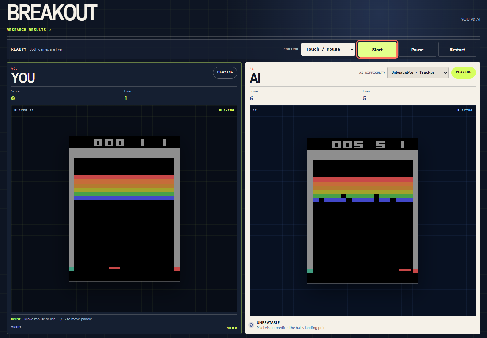
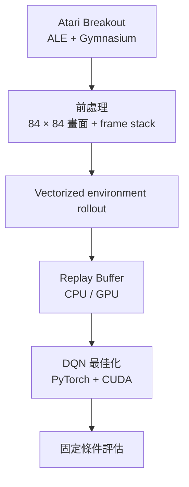
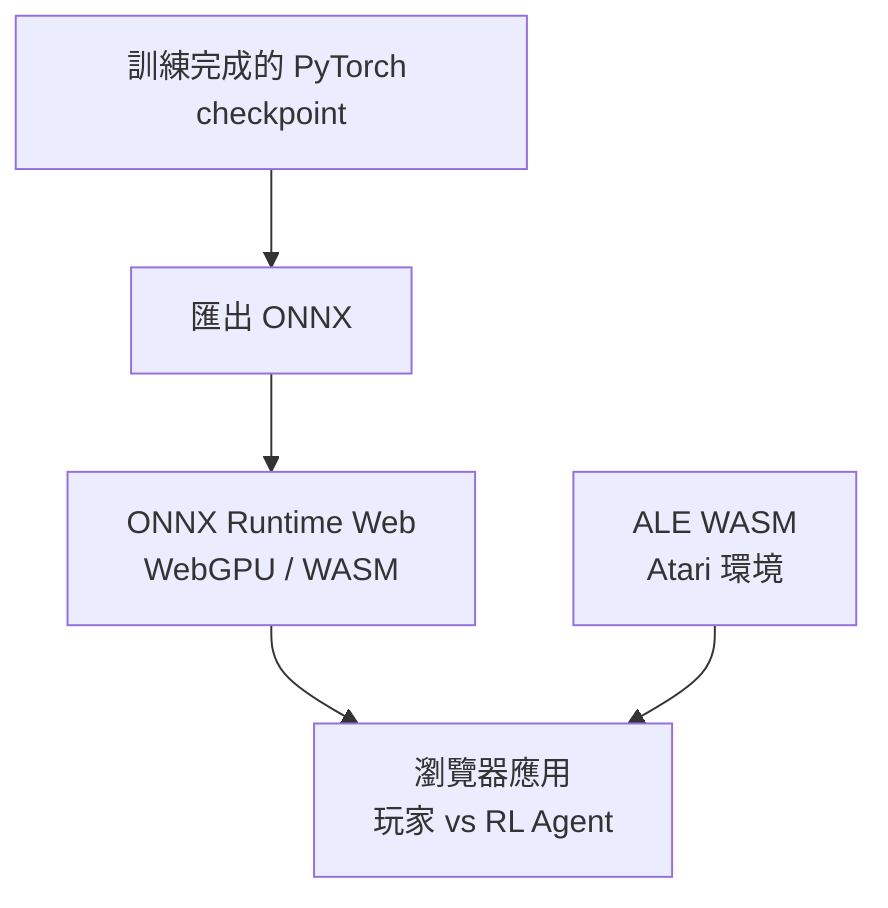

# Breakout RL Engineering

[English](README.md) · [線上 Demo](https://breakout.tommypan.com) · [案例研究](https://breakout.tommypan.com/case-study.zh-TW) · [最終結果](docs/final-results/README.md) · [重現路徑](docs/repro/README.md) · [30 天鐵人賽文章](https://github.com/Tommyweige/breakout-rl-engineering/tree/docs-ironman-series)

**一支從沒訓練過的程式，打贏了這個專案訓練出來的神經網路。** 追蹤程式在 15 場正式對局中打光兩面牆 4 次，平均 721.8 分；同一套規則下（每格畫面做一次決定、同樣那 15 局），訓練過的神經網路平均 6.93 分。

| 打光兩面牆 | 追蹤程式平均分 | 同規則的神經網路平均分 |
| :---: | :---: | :---: |
| **4／15 局** | **721.8** | **6.93** |

**[在瀏覽器裡試玩](https://breakout.tommypan.com)** · **[讀 30 天案例研究](https://breakout.tommypan.com/case-study.zh-TW)**



## 專案概述

這是一個以 Atari Breakout 為主題的端到端強化學習工程專案，涵蓋 DQN 訓練、可重現評估、CUDA 加速、ONNX 推論，以及瀏覽器部署。

最終應用會直接在瀏覽器中執行 Atari 環境與訓練完成的 RL policy，不需要 Python backend。

> **專案狀態：已完成，證據在 2026-10-29 凍結。** 這是一個做完的工程案例，不再繼續訓練。最後的結果是：追蹤程式在 15 局正式對局中有 4 局打到 864 分、打光兩面牆，平均 721.8 分。給一般讀者的完整故事在 [案例研究](https://breakout.tommypan.com/case-study.zh-TW)；每個數字的來源、規則版本與限制整理在 [`docs/final-results/`](docs/final-results/README.md)。

## 重點發現

- **沒有訓練的像素追蹤程式，在官方 15 局中打光兩面牆 4 局。** 在 Contract v3（每格畫面決策一次）下平均 **721.8** 分（median 810、max 864）（[報告](audits/browser-clear/native-15/report.md)）。
- **同一套規則下，訓練過的 DQN 平均 6.93 分。** Dueling Double DQN 在 Contract v3 訓練 2M frames，最好的一局 12 分，一面牆都沒有打光（issue #23）。
- **部署的 DQN 能在瀏覽器裡玩。** Dueling Double DQN 在 DQN / Double DQN / Dueling 的比較中勝出；2.5M-transition 模型在 Contract v2 下 holdout mean **30.933**，透過 ONNX Runtime Web 在瀏覽器執行。
- **先前的 137.47 來自還沒修完的控制器，不是方法的上限。** 那次評估（15 局 0 次打光）可一字不差重現（[腳本](audits/browser-clear/reproduce-137-47.py)）；最高分 341 沒有到第一面牆的 432 分。修正速度估計與球拍放開時機之後，同一套評估得到 721.8。
- **破關偵測器在真實的兩面牆全清軌跡上測過。** 兩條可重播的 ALE 破關軌跡在第二面牆清空的那一步被判定打光，只清一部分的軌跡不會；故意改壞的 6 種偵測器全部被抓到。偵測器狀態 unknown 時報 unknown，不會報成 0（[`docs/clear-semantics.md`](docs/clear-semantics.md)）。
- **搬進瀏覽器的版本結果一致。** 同一套控制律改寫成 TypeScript，在 ALE WASM 上跑 120 局，43 局打光兩面牆，平均 731.4（[audit](audits/browser-clear/README.md)）。
- **負面結果也留在紀錄裡。** Life-loss reward shaping 未通過 promotion gate；優先回放（PER）的小幅進步不值得多花的訓練時間；DQN first-clear probes 沒有打光；Laya Vision side experiment 在瀏覽器裡跑起來了，但沒有做正式評估。

瀏覽器 UI 的 Easy、Medium、Hard 都跑這個 DQN policy，分別注入 30%、15%、5% 的刻意失誤；**「Unbeatable」改跑影像追蹤程式**，不經過神經網路、也不注入失誤。

## 專案重點

- **DQN 系列模型** — Vanilla DQN、Double DQN、Dueling Double DQN。
- **GPU 訓練** — 使用 PyTorch、CUDA 與 vectorized environments。
- **Replay 系統** — CPU 與 GPU Replay Buffer 實作。
- **可重現評估** — 透過 machine-readable contract 固定環境與評估語義。
- **推論流程** — PyTorch、ONNX 與 ONNX Runtime。
- **瀏覽器部署** — 使用 ALE WASM 執行 Atari，並以 ONNX Runtime Web 執行 policy inference。
- **工程化結構** — reusable Python package、CLI、active configs、regression tests 與 production web app。

## 系統架構

### 訓練與評估



Vanilla DQN、Double DQN 與 Dueling Double DQN 都使用相同的環境與評估 contract，方便在一致條件下比較。

### 部署流程



瀏覽器端會同時執行 Atari emulator 與 ONNX policy，因此遊戲與模型推論都不需要 Python backend。

## 專案結構

```text
breakout_rl/   可重用的 RL、訓練、評估與推論程式碼
configs/       目前使用中的訓練、評估與推論設定
scripts/       訓練、評估、分析與 benchmark CLI
tests/         核心 correctness 與 regression tests
web/           瀏覽器應用與 runtime model assets
```

`main` 分支只保留目前維護中的實作與產品程式碼。30 天鐵人賽文章放在 [`docs-ironman-series`](https://github.com/Tommyweige/breakout-rl-engineering/tree/docs-ironman-series) 分支：分支的 `README.md` 是總目錄，每一天是一篇放在 `articles/` 的 Markdown。

## Environment Contract

Atari RL 的結果會受到 frame skip、frame stack、sticky actions、FIRE handling、life-loss handling 與 episode limit 等環境條件影響。

歷史 benchmark 使用：

```text
configs/eval/breakout_contract_v2.json
```

需要精細控制時，訓練與評估可明確選用：

```text
configs/eval/breakout_contract_v3.json
```

Contract v2 每個 policy decision 推進四個模擬器影格；v3 每個 decision
推進一個影格，並保留相同的 108,000 個 ALE episode 影格上限與其他遊戲
設定。因此兩者的 agent-step 上限分別是 27,000 與 108,000。訓練和評估
摘要會分開記錄 agent steps 與 emulator frames；影格數取自 ALE 原生計數器。
使用 `--contract configs/eval/breakout_contract_v3.json` 明確選用 v3；預設仍是
v2。比較結果時請一併確認 artifact 記錄的 contract ID 與路徑。

## 訓練

目前保留的訓練入口：

```text
scripts/training/train_dqn.py
scripts/training/train_vectorized_dqn.py
```

Vectorized training path 用於提高資料收集 throughput，並搭配 CUDA 執行模型最佳化。

Baseline 設定包含：

```text
configs/dqn_baseline.json
configs/double_dqn_baseline.json
configs/dueling_double_dqn_baseline.json
configs/dueling_double_dqn_life_loss_penalty.json
```

Issue #9 的 reward shaping 實驗會把 raw Atari reward 與 replay/training
reward 分開保存。Baseline 使用 `life_loss_penalty: 0.0`，實驗版本使用
`-1.0`，而且只在 `info["fire_reset_life_loss"]` 為 true 時套用。評估時
仍然只回報原始 Breakout 分數。

Stage 2 的可重現 screening sweep 使用 Dueling Double DQN、training seed
`2022`、`250000` 個 environment transitions；除了 penalty 之外的條件
完全一致，比較 `0.0`、`-0.25`、`-0.5`、`-1.0`：

```bash
python -m scripts.training.run_reward_shaping_sweep \
  --output-dir experiments/issue-9-reward-shaping/stage2-250k --parallel
python -m scripts.evaluation.evaluate_reward_shaping_sweep \
  --stage-dir experiments/issue-9-reward-shaping/stage2-250k
```

每個 run 都會保存 config、checkpoint、metrics、runtime summary、Q/TD-error
diagnostics、survival metrics、analysis report 與 learning curves。評估使用
預先宣告的 50 組 seed，且只比較 raw score。Stage 2 只是 candidate screening，
不會提升任何模型，也不會覆蓋既有 Day 30 formal artifacts。

## 評估

目前保留的評估入口：

```text
scripts/evaluation/baseline_random_agent.py
scripts/evaluation/evaluate_dqn.py
scripts/evaluation/evaluate_vectorized_dqn.py
scripts/evaluation/evaluate_reward_shaping.py
scripts/evaluation/evaluate_reward_shaping_sweep.py
scripts/evaluation/evaluate_predictive_controller.py
```

評估流程與訓練流程分離，讓不同模型能在一致的 task semantics 下進行比較。

確定性預測控制器直接使用 ALE RGB 畫面，不需要訓練模型。版本化設定檔
沿用 Breakout Contract v3 的一影格決策頻率與固定 evaluation seeds，不修改
共用的 v2 或 v3 contract：

```bash
python -m scripts.evaluation.evaluate_predictive_controller \
  --config configs/eval/breakout_vision_controller_v1.json \
  --output-dir outputs/issue25-vision-controller
```

執行後會保存每局分數與 canonical clear detections、感知/控制診斷、第一局 ALE 逐步軌跡，
以及精簡比較報告。控制器只讀取畫面；FIRE handling 和 canonical clear detection
仍由外部環境與評估流程負責。Clear 計數來自 audited `BreakoutCompletionDetector`。
軌跡與動作分布區分 `requested_action`（controller 原始決策）與 `ale_input_action`
（FIRE wrapper 覆寫後送進 ALE 的動作）。ALE sticky actions 可能重複上一個動作；
目前無法觀察 ALE 決定後真正執行的 physical action。

## 瀏覽器 Demo

**線上版本：** https://breakout.tommypan.com

**研究結果：** https://breakout.tommypan.com/case-study

Case-study 頁面是獨立、可直接連結的研究問題、方法演進、contract、結果與限制摘要。主遊戲頁可以明顯進入該頁，且不改變 Human vs AI 遊玩介面。

Web application 使用：

- [`@farama/ale-wasm`](https://www.npmjs.com/package/@farama/ale-wasm)：在瀏覽器執行 Atari emulator。
- [`onnxruntime-web`](https://www.npmjs.com/package/onnxruntime-web)：執行訓練完成的 policy。
- TypeScript + Vite：瀏覽器應用。
- WebGPU / WASM：依照瀏覽器能力選擇推論執行路徑。

### 模型檔案

**整個專案只公開一個模型可供下載：** 也就是部署中的 Dueling Double DQN（2.5M transitions、seed 2022、Contract v2 holdout mean 30.933），放在 Hugging Face 的 [huggingface.co/TommyPanLab/breakout-dueling-double-dqn](https://huggingface.co/TommyPanLab/breakout-dueling-double-dqn)。

| 檔案 | 位置 |
|---|---|
| `model.pt`：原始 PyTorch checkpoint，附 `metadata.json`（訓練設定、selection 與 holdout 評估） | 只在 Hugging Face |
| `model.onnx`：瀏覽器執行的 fp32 ONNX，附 `model.onnx.metadata.json` | Hugging Face，以及本 repo 的 [`web/public/models/final_model/`](web/public/models/final_model/) |

過程中訓練的其他 checkpoint（family screen、reward shaping、PER、Contract v3 baseline），以及從這個模型轉出的 fp16 ONNX / TensorRT engine 都沒有公開。“Unbeatable” 背後的確定性像素控制器是程式碼，不是模型。

## 快速開始

完整乾淨 clone 流程、系統依賴、ALE ROM 來源、conda 與 venv 的取捨、已知測試失敗、CI 與版本標記都在 [`docs/repro/`](docs/repro/README.md)。

### Python

CPU-only、Linux（以 Python 3.12.15 實測）。最小的 Ubuntu/Debian 映像要先裝
interpreter 與 OpenCV 需要的 X/GL runtime：

```bash
sudo apt-get update
sudo apt-get install -y python3.12 python3.12-venv \
  libxcb1 libgl1 libglib2.0-0 libxext6 libsm6 libice6
```

再來：

```bash
python3.12 -m venv .venv
source .venv/bin/activate
python -m pip install --upgrade pip
python -m pip install --index-url https://download.pytorch.org/whl/cpu "torch==2.13.0+cpu"
python -m pip install \
  "ale-py==0.12.0" "gymnasium==1.3.0" "onnx==1.19.0" "onnxruntime==1.31.1" \
  "numpy==2.5.4" "matplotlib==3.11.2" "pillow==13.0.0" "opencv-python==5.0.0.93"
```

或使用 conda（會安裝 CUDA 13 wheels，約 6.3 GB）：

```bash
conda env create -f environment.yml
conda activate breakout-rl-engineering
```

最小的 Linux 映像要先裝上面 apt 區塊的 X/GL library；它們是 OpenCV wheel 的
runtime 依賴。

`ale-py==0.12.0` 已內建 Breakout ROM，不需要另外下載。用一條指令跑單元測試與端到端 smoke：

```bash
python -m scripts.smoke.run_smoke --output-dir outputs/smoke
```

通過時約兩分鐘，最後一行是 `Smoke: PASS`。單元測試現在是 340 個、沒有失敗，只有依硬體而定的 skip，所以 `Smoke: PASS` 代表測試真的過了；詳見 [`docs/repro/known-test-failures.md`](docs/repro/known-test-failures.md)。

### Web

Node.js >= 20.19（以 v22.23.3 實測）：

```bash
cd web
npm ci
npm run dev      # http://localhost:5173/
```

Production build：

```bash
npm run build
```

請用 `localhost`，不要用 `127.0.0.1`；原因與其他排錯方式見 [`docs/repro/setup.md`](docs/repro/setup.md#troubleshooting)。

## 技術棧

**RL / ML**

- Python 3.12
- PyTorch
- Gymnasium
- ALE / `ale-py`
- NumPy

**Inference / Deployment**

- ONNX
- ONNX Runtime GPU
- ONNX Runtime Web
- WebGPU / WASM

**Web**

- TypeScript
- Vite
- Vitest
- Cloudflare Pages / Wrangler

## 最終結果

凍結的證據包在 [`docs/final-results/`](docs/final-results/README.md)：

- [`README.md`](docs/final-results/README.md)：results index、contract 對照、限制與可重跑指令。
- [`summary.json`](docs/final-results/summary.json)：machine-readable metrics，包含 `value`、`unit`、`contract`、`seed_count`、`source`、`ref`、`verification_status`。
- [`evidence-inventory.csv`](docs/final-results/evidence-inventory.csv)：實驗 ledger 與 raw-artifact 狀態。
- [`artifact-manifest.json`](docs/final-results/artifact-manifest.json)：預期 raw artifact 路徑、producer、hash，以及 missing/not-created 狀態。
- [`handoff.md`](docs/final-results/handoff.md)：deferred work、Laya blockers、release/deploy/rollback 與 `tommypan.com` 交接。

每個分數都屬於某個 contract 與 commit。同一份 contract 的對照是 Contract v3：DQN 6.93 / 0 clears 對 controller 721.8 / 4 of 15，在 `a8445df` 量測，controller 來自 #68。部署的 DQN 的 30.933 holdout 是 Contract v2 數字；先前的 137.47 是 PR #26 `50ee352` 的 controller。

凍結證據包由 commit `77a0c7b` 加入。任何新數字都應標記產生它的 commit（tag + 完整 SHA），方式見 [`docs/repro/versioning.md`](docs/repro/versioning.md)。

## 已知限制

- DQN、reward shaping、PER 與 Laya 的原始 run outputs 不在 `main`；對應數字屬於 historical reported，無法只靠這個 checkout 獨立重現。Controller 結果（`a8445df` native 15 局、137.47 重現、120 局 WASM audit）在 [`audits/browser-clear/`](audits/browser-clear/README.md)。
- Clear 計數都是 canonical clear detections；沒有任何 controller run 通過 artifact provenance 驗證。4/15 是單一 deterministic controller、單一 seed 清單，不是 reliable-clear rate。
- Contract v2 與 v3 改變決策頻率，所以 DQN 的 30.933 holdout 與 controller 不能直接比較。沒有執行 matched cross-contract 對照，因此這些結果不能拿來替方法排名。
- DQN holdout 是單一模型、15 局；Contract v3 DQN baseline 只有一個 training seed（seed 11）；controller 結果是單一 15-seed run（120 局 WASM audit 是補充）。
- Laya 有延遲量測，但沒有正式評估過的 episode。PR #74 已關閉、沒有合併，封存為 tag `archive/issue69-laya-vision`；issue #69–#72 都已關閉。
- 本次收尾沒有完成 50-episode browser evaluation，也沒有世界紀錄或 human-timed 挑戰。
- 乾淨 checkout 的單元測試是綠的：340 個測試、沒有失敗，只有依硬體而定的 skip（4 個 ONNX policy 測試需要沒進 repo 的 Day 22 模型）。[`docs/repro/known-test-failures.md`](docs/repro/known-test-failures.md) 記錄了 `main` 清理刪掉哪些測試，以及記錄下來的 contract 雜湊如何固定成 LF。

## 文件

開發筆記與 30 天鐵人賽文章放在 `docs-ironman-series` 分支：分支的 `README.md` 是 30 篇文章的總目錄，每一天是一篇放在 `articles/` 的 Markdown：

[**瀏覽 30 天鐵人賽文章 →**](https://github.com/Tommyweige/breakout-rl-engineering/tree/docs-ironman-series)

凍結收尾文件在 `main`：

[**最終結果索引 →**](docs/final-results/README.md) · [**交接與 deferred work →**](docs/final-results/handoff.md)

重現路徑在 `main`：

[**乾淨 clone 安裝 →**](docs/repro/setup.md) · [**Smoke 路徑 →**](docs/repro/smoke.md) · [**CI →**](docs/repro/ci.md) · [**版本標記 →**](docs/repro/versioning.md)

## 授權 / License

本專案以 **GNU General Public License v2.0** 釋出，完整條文見 [`LICENSE`](LICENSE)。第三方元件（例如 `web/vendor/ale-wasm`）與它隨附的 Atari `breakout.bin` ROM 見 [`NOTICE`](NOTICE)；該 ROM 著作權屬 Atari，不在本專案的授權範圍內。
