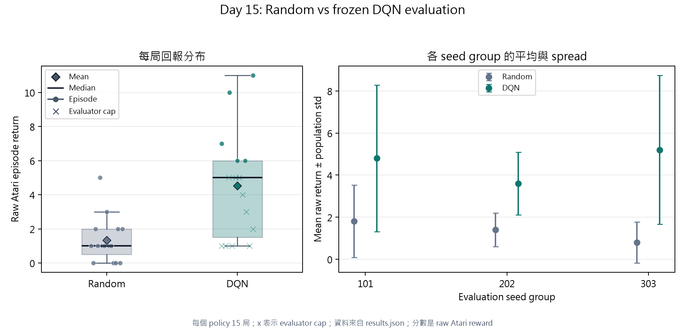

# Day 15｜DQN milestone evaluation

## 先看結論

在固定的 evaluation protocol 下，本次結果分類為 **B：DQN 觀察平均較高，但有 evaluator cap 的局，尚不能當作完整終局的穩定優勢**。這個分類只描述本次已收集的 episode samples，不是多個 training seeds 的統計顯著性檢定。

Random 的平均 raw Atari return 是 **1.33**，DQN 是 **4.53**，平均差值為 **3.20**；中位數則是 1.00 對 5.00。
這裡的 raw reward 是環境回傳的原始遊戲分數，沒有沿用訓練時的 reward clipping。

## Day 14 的學習訊號，為什麼還不算 milestone

Day 14 的 100K 曲線與單局 GIF 是 development evidence：它們讓我們知道訓練流程出現值得追蹤的訊號。正式 milestone 要回答的是同一個凍結 checkpoint 在沒有更新權重、沒有寫 Replay Buffer、沒有繼續套用 training epsilon schedule 的情況下，能否在一組事先固定的環境隨機性中穩定行動。
因此本次使用 Day 14 final 100K checkpoint；checkpoint rule 在看 evaluation 結果前就已固定，沒有從 50K、75K、100K 中挑最好的一局。

### Day 14 candidate provenance

| 欄位 | 實際值 |
|---|---|
| source manifest | `experiments/day14-final-frozen-100k/manifest.json` |
| source run | `day14-final-vanilla-dqn-seed42` |
| checkpoint | `assets/day14/final-runs/day14-final-frozen-100k/day14-final-vanilla-dqn-seed42/checkpoints/step-00100000.pt` |
| checkpoint SHA-256 | `022bda1ea5bb1ebcb0535ebb522fc954af11fd43607e124d5e5dc7a2aec3b79b` |
| checkpoint step | 100,000 |
| training seed | 42 |
| training budget | 100,000 environment steps |
| learning rate | `0.0002` |
| batch size | 32 |
| replay backend | `cpu` |
| selection rule | final checkpoint at 100000 environment steps |
| Day 14 trainer PyTorch / CUDA | `2.13.0+cu130` / `13.0` |
| Day 14 trainer commit | `8696d6eaf8a8f3cab18f75661e83113ad5025102` |
| GPU profiling source | `experiments/day14-batch-size-profiling-final/batch-size-comparison.json` |
| selected batch end-to-end SPS | 235.74 |
| selected GPU utilization mean | 30.13% |
| selection rationale | candidate requires completed 10K, finite metrics, and end-to-end SPS strictly above batch 32；validate every short-stage candidate with 100K learning metrics before freezing；do not select a batch size from GPU utilization alone when return or numerical guardrails regress |

## 固定的評估規則

評估時的 policy 是已凍結的行動規則；它只接收 observation，選一個合法 action，再把環境回傳的 raw reward 累積到該局結束。Random 與 DQN 共用 environment construction、seed handling、episode loop、terminated/truncated 判斷與輸出 schema。

| 規則 | 值 |
|---|---|
| environment | `ALE/Breakout-v5` |
| observation shape | `[4, 84, 84]` |
| action count | 4 |
| evaluation seed groups | `[101, 202, 303]` |
| episodes per seed group | 5 |
| total episodes per policy | 15 |
| DQN epsilon | 0.0 (greedy) |
| score | raw Atari reward; no training reward clipping |
| DQN requested device | `cuda` |
| DQN resolved device | `cuda:0` |
| GPU | `NVIDIA GeForce RTX 4060 Laptop GPU` |
| PyTorch / CUDA | `2.13.0+cu130` / `13.0` |

DQN 的模型推論確實在 NVIDIA CUDA 上執行；Random 沒有神經網路推論，因此使用 CPU 不構成效能比較。本報告比較的是遊戲回報，不是兩者的 latency 或 steps per second。

## 不只看平均：每局結果與 spread

平均值適合描述整批樣本的中心，但它可能被少數高分或低分拉動。中位數是排序後位於中間的回報，比較不容易被極端局影響；std 是每局回報離平均值的典型距離，這裡使用 population standard deviation（把本次完整收集的 episode 當成要描述的整體）來呈現 spread。

| Policy | N | complete | evaluator cap | mean | median | std | min | max | mean episode length |
|---|---:|---:|---:|---:|---:|---:|---:|---:|---:|
| Random | 15 | 15 | 0 | 1.33 | 1.00 | 1.30 | 0.00 | 5.00 | 185.73 |
| DQN | 15 | 5 | 10 | 4.53 | 5.00 | 3.07 | 1.00 | 11.00 | 6800.07 |

下圖的每一個點都是 evaluation JSON 裡的一局，不是由平均值反推的資料；箱型圖保留中間分布，菱形是 mean，短線是 median。右圖再把同一個 evaluation seed group 的平均與 spread 分開，方便觀察結果是否只由某一組 seed 推高。

這張圖支持的結論是「本次 samples 中兩個 policy 的回報中心與分布如何重疊」，不能單獨證明 DQN 對所有未來 Breakout 起始狀態都更好，也不能把 Random CPU 與 DQN CUDA 的執行時間拿來比較。

### Per-seed / per-episode raw returns

| Evaluation seed group | Episode | Concrete reset seed | Random return | DQN return | DQN stop |
|---:|---:|---:|---:|---:|---|
| 101 | 1 | 101 | 1.00 | 1.00 | max_steps |
| 101 | 2 | 102 | 0.00 | 7.00 | terminated |
| 101 | 3 | 103 | 2.00 | 1.00 | max_steps |
| 101 | 4 | 104 | 1.00 | 10.00 | terminated |
| 101 | 5 | 105 | 5.00 | 5.00 | max_steps |
| 202 | 1 | 202 | 1.00 | 1.00 | max_steps |
| 202 | 2 | 203 | 1.00 | 5.00 | max_steps |
| 202 | 3 | 204 | 3.00 | 5.00 | max_steps |
| 202 | 4 | 205 | 1.00 | 4.00 | max_steps |
| 202 | 5 | 206 | 1.00 | 3.00 | max_steps |
| 303 | 1 | 303 | 0.00 | 1.00 | max_steps |
| 303 | 2 | 304 | 0.00 | 2.00 | max_steps |
| 303 | 3 | 305 | 2.00 | 6.00 | terminated |
| 303 | 4 | 306 | 0.00 | 6.00 | terminated |
| 303 | 5 | 307 | 2.00 | 11.00 | terminated |

## 這次結果能說到哪裡

本次固定協議得到的觀察是：DQN 平均回報比 Random 高 3.20 分，中位數則較高。分類 **B** 的門檻只是透明的描述性規則，不能取代更多 training seeds 或正式統計檢定。

DQN 有 **10 / 15** 局在 evaluator 的 10,000 步安全上限停止；這些回報是到上限為止的累積值，不是環境自然終局的完整 return。因此本次雖然觀察到 DQN 的中心值較高，仍不能把它寫成「所有完整 episode 都穩定超過 Random」。

目前仍只有一個 training seed（Day 14 seed 42）。training seed 影響模型初始化、探索與 Replay 抽樣；evaluation seed 則控制凍結 policy 在環境中遇到的隨機性。這次使用 101、202、303 三個獨立 seed group，所以它能檢查多局表現，卻還不能宣稱 multi-training-seed robustness。

如果 DQN 沒有超過 Random，正確解讀是這個 100K candidate 尚未通過正式 milestone，而不是立刻斷言 CNN 容量不足；下一步應保留 evaluation evidence，再用更長的 training horizon、多個 training seeds 或後續演算法比較釐清原因。

## Day 16 的品質基準

Day 16 會把單一環境訓練改成多環境、批次 action inference 與批次 GPU Replay insertion。這套 evaluation contract 不隨 systems optimization 改變：仍使用相同 seeds、每個 seed 的 episodes、epsilon=0、raw reward、preprocessing、terminated/truncated semantics 與 result schema。Day 16 要重新回答的不是「速度變快了嗎」而已，而是「速度改造有沒有讓 policy quality 明顯退步」。

### 可重建的 artifacts

- Random JSON：`evaluations/day15-random-baseline/results.json`
- DQN JSON：`evaluations/day15-dqn-cuda/results.json`
- Random CSV：`evaluations/day15-random-baseline/episodes.csv`
- DQN CSV：`evaluations/day15-dqn-cuda/episodes.csv`
- 圖表由 `visualize_day15_evaluation.py` 從兩份 JSON 重新產生。
- 結果由 `evaluate_dqn.py` 使用 `configs/eval/breakout_eval.json` 產生；正式 DQN 命令指定 `--device cuda`。

Report generated at `2026-08-27T08:52:54.034629Z`。
